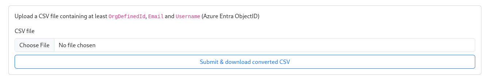

# Student List Service

Simple web server to convert exported Ufora (D2L Brightspace) student list containing Azure Entra ID usernames to a student list with UGent GitHub usernames.





## Usage

### Hosted

~~A hosted version of the service is available at http://10.10.210.41/. Accessible inside the IDLab network (VPN or iGent).~~

Please contact Michiel Van Kenhove (UGent-imec) via email or Teams if you need to convert .csv's until the issue with the hosted version gets resolved.

### Local

We recommend to use a Python virtual environment.


1. Install the required dependencies:

    ```bash
    pip install -r requirements.txt
    ```

2. Update the `.env` file with the provided credentials.

3. Start the app:

    ```bash
    flask run
    ```

4. The app should now be accessible at http://localhost:5000/

